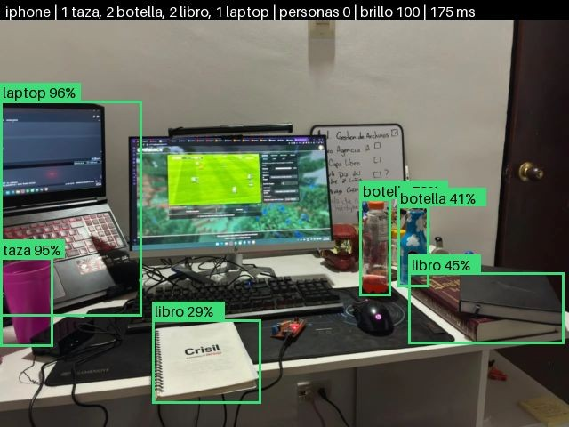
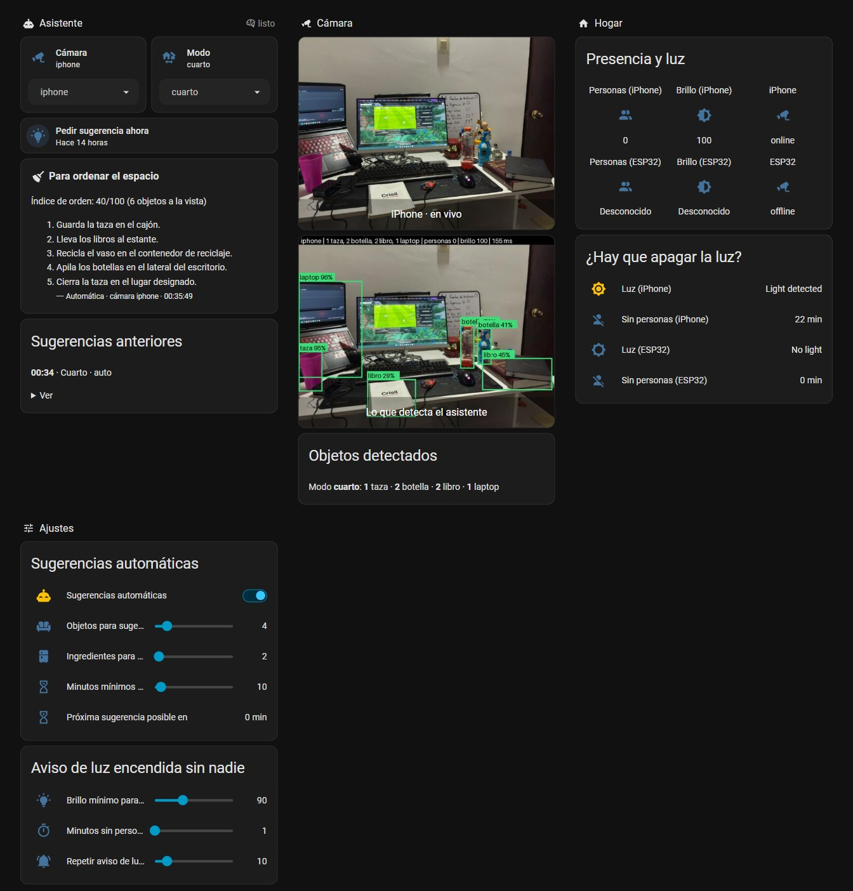
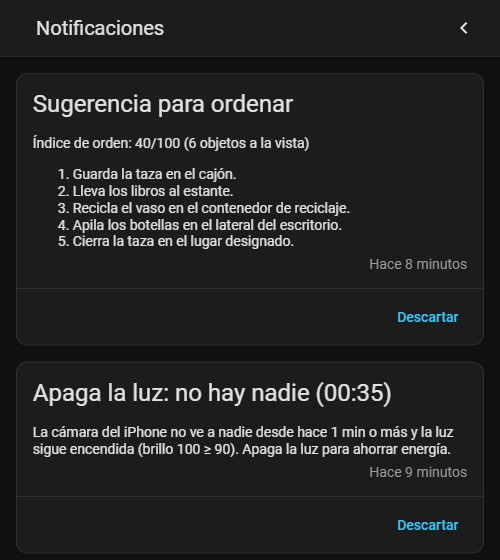

# Asistente doméstico con visión — Documentación del proyecto

Proyecto final de Inteligencia Artificial. Un asistente doméstico que **mira** un espacio con cámaras,
**entiende** qué objetos hay y **actúa**: propone recetas con lo que hay en la nevera, sugiere cómo ordenar
un cuarto desordenado, mantiene una lista de compras y avisa cuando quedó una luz encendida sin nadie.
Todo corre **localmente** en una Raspberry Pi 5, sin servicios en la nube.

## 1. Objetivo

| Requisito del curso | Cómo se cumple |
|---|---|
| Punto 2: ESP32-S3 + Home Assistant + modelo FOMO de Edge Impulse que cuenta objetos | Firmware `firmware/esp32_fomo_mqtt` (FOMO int8 + EON) que publica el conteo por MQTT; HA lo muestra y automatiza |
| Montado en una Raspberry Pi con la cámara ESP32-S3 | Todos los servicios en Docker en la Pi 5; la ESP32-S3 (Goouuu) como cámara |
| Modelo de IA local tipo Ollama que actúe como asistente | Ollama con `gemma3:1b` en la Pi genera recetas y consejos de orden |
| Comportarse como un asistente del hogar | Sugerencias automáticas, lista de compras, aviso de luces, resumen diario, notificaciones |

**Idea central:** la visión y el razonamiento están separados. Los detectores (FOMO en el ESP32, YOLO en la Pi)
convierten la imagen en una **lista de objetos**; el LLM solo recibe esa lista en texto.
**Por qué:** un modelo de lenguaje con visión tardaría minutos por imagen en una Raspberry Pi y consumiría
más energía de la que la Pi puede entregar; un detector tarda milisegundos y el LLM pequeño trabaja con poco texto.

## 2. Arquitectura

```
 ESP32-S3 (MJPEG :81) ──┐                      ┌──▶ Home Assistant: video en vivo
                        ├──▶ go2rtc (relé) ────┤
 iPhone (MJPEG :8081) ──┘                      └──▶ vision: YOLOv8n ──┐
                                                                      │ MQTT (Mosquitto)
 ESP32 con firmware FOMO ── casa/camara1/detecciones ─────────────────┤
                                                                      ▼
                                   cerebro: mediana · sugerencias automáticas · historial (SQLite)
                                                                      │ prompt de texto
                                                                      ▼
                                                             Ollama (gemma3:1b)
                                                                      │
                                         respuesta ──▶ Home Assistant: dashboard, notificaciones
```

Diagramas detallados en `docs/arquitectura.md`; tópicos y formatos en `docs/contrato.md`.

Integrantes: Cesar Camilo Hoyos Diaz (20222207570), Álvaro Julián Delgado Mena (20222208840), Dawin Alexis Guarin Ipuz (20202192954).

### 2.1 Componentes, qué hacen y por qué existen

| Componente | Qué hace | Por qué / para qué |
|---|---|---|
| **ESP32-S3 + FOMO** (Edge Impulse) | Detecta y cuenta objetos en el propio microcontrolador (TinyML) | Requisito del curso; procesa en el borde y solo envía ~100 bytes de JSON (privacidad, poco ancho de banda) |
| **iPhone + IP Camera Lite** | Segunda cámara por MJPEG | Cámara de mejor calidad para la demostración mientras se entrena el modelo FOMO |
| **go2rtc** | Mantiene **una sola conexión** con cada cámara y la reparte | Las cámaras solo admiten un cliente de video; sin relé, HA y vision se quitaban el stream y había cortes |
| **vision** (YOLOv8n ONNX) | Detecta objetos COCO, personas y mide el brillo de cada cámara | Da detección real desde ya (sin entrenar) y habilita presencia/luces; ONNX Runtime es liviano en ARM |
| **Mosquitto** (MQTT) | Bus de mensajes entre todas las piezas | Desacopla: cada pieza se cambia sin tocar las demás si respeta el contrato |
| **cerebro** (Python) | Estabiliza el conteo, decide cuándo sugerir, consulta al LLM, guarda historial | Concentra la lógica del asistente en un servicio pequeño y probado con tests |
| **SQLite** | Historial de cambios de inventario y de sugerencias | Función "úsalo pronto" y evidencia para el informe |
| **Ollama** (`gemma3:1b`) | Genera recetas y consejos en español | LLM local, sin internet; el modelo de 1B cabe y responde en la Pi |
| **Home Assistant** | Dashboard, ajustes, automatizaciones y notificaciones | Plataforma estándar de domótica: lo que el usuario ve y usa |

## 3. Funciones del asistente

### 3.1 Sugerencias automáticas (cuarto y cocina)
El asistente sugiere **solo**, sin que nadie pulse un botón, y la sugerencia **se mantiene** en pantalla:

1. **Suficientes objetos:** cuarto ≥ 4 objetos (tazas, botellas, libros, mochila, laptop, celular, zapatos);
   cocina ≥ 2 ingredientes. Ajustable en el dashboard.
2. **Escena estable 20 s:** no reacciona a algo que pasa por delante de la cámara.
3. **Intervalo mínimo** entre sugerencias (10 min por defecto, ajustable): la sugerencia vigente no cambia antes.
4. **Solo si la escena cambió** (≥ 2 objetos de diferencia); si nada cambió, repite a la hora como recordatorio.
5. Cocina y cuarto se evalúan **por separado**: puede dejar una receta y, más tarde, un consejo de orden.

**Por qué así:** el conteo de un detector fluctúa entre cuadros. Sin estas reglas, el asistente cambiaría de
sugerencia cada pocos segundos, consumiría el LLM sin parar (y energía de la Pi) y sería molesto de usar.

Cada sugerencia queda en el historial (dashboard, "Sugerencias anteriores") y genera una notificación.
El botón **"Pedir sugerencia ahora"** sigue disponible para pedir una al instante.

### 3.2 Estabilizador de conteo
Mediana de las últimas 5 lecturas por clase y por cámara. **Por qué:** elimina picos aislados del detector
(un objeto que aparece en un solo cuadro) sin retrasar mucho los cambios reales.

### 3.3 Aviso de luz encendida sin nadie
Cada minuto, para cada cámara en línea: si **no ve personas desde hace N minutos** y el **brillo** de la imagen
supera el umbral, notifica "Apaga la luz: no hay nadie". No repite antes de 15 minutos y el aviso se quita solo
cuando alguien vuelve. Con una bombilla o enchufe inteligente en HA se puede apagar la luz automáticamente
(acción incluida y comentada en `pi/ha/automations.yaml`).
**Por qué el brillo:** no hay sensores de luz; la propia cámara indica si la habitación está iluminada.
Calibración: medir el brillo con la luz encendida y apagada y poner el umbral en el punto medio.

### 3.4 Lista de compras y resumen diario
- Menos de 2 huevos o 0 leche durante 20 s → se añade a la lista de compras y se notifica.
- A las 19:00, HA pide una receta en modo cocina y la envía como notificación con lo que falta.
- "Úsalo pronto": el prompt de cocina prioriza el ingrediente que lleva más días en el inventario.

### 3.5 Dos cámaras intercambiables
En el dashboard se elige la **cámara del asistente** (`camara1` = ESP32, `iphone`). Cada cámara tiene su propio
inventario; las sugerencias usan el de la cámara activa.

## 4. Modelos de IA

| Modelo | Dónde corre | Para qué | Optimización |
|---|---|---|---|
| FOMO (MobileNetV2) | ESP32-S3 | Contar objetos propios (huevo, leche, tomate…) | int8 + EON Compiler, entrada 96×96 en gris, ESP-NN |
| YOLOv8n / YOLOv8s (COCO) | Pi, contenedor vision | Objetos comunes + personas | ONNX Runtime CPU; YOLOv8n 320 px o YOLOv8s 640 px (`VISION_MODELO`), NMS en numpy |
| gemma3:1b (Q4) | Pi, Ollama | Recetas y consejos en texto | Cuantizado, `num_ctx` 2048, `num_predict` 350, `temperature` 0.3, `keep_alive` 30 min |

**Por qué estos tamaños:** la Pi comparte recursos con otro proyecto y se alimenta con una fuente limitada;
se eligieron los modelos más pequeños que dan resultados útiles (YOLO "nano", LLM de 1B parámetros).
Los prompts (`pi/cerebro/prompts.py`) obligan al LLM a usar **solo** los objetos detectados, para no inventar.

## 5. Dashboard (Home Assistant)

Vista por secciones (`pi/ha/dashboard.yaml`):

| Sección | Contenido |
|---|---|
| Asistente | Cámara y modo, botón de sugerencia, sugerencia vigente (receta u orden), sugerencias anteriores |
| Cámara | Video en vivo (go2rtc) y la imagen con lo que detecta el asistente (cajas dibujadas), objetos detectados |
| Hogar | Personas y brillo por cámara, estado de cada cámara, lista de compras |
| Ajustes | Sugerencias automáticas (activar, mínimos, intervalo, próxima) y aviso de luz (umbral, minutos) |

## 6. El sistema en funcionamiento
Escena de un escritorio vista por la cámara del iPhone, procesada por el sistema completo
(go2rtc → vision → cerebro → Ollama → Home Assistant) en modo cuarto.







1. vision detecta los objetos de la escena y publica el conteo, las personas y el brillo.
2. Con 6 objetos y la escena estable 20 s, cerebro genera **sola** la sugerencia de orden: el índice (40/100) lo
   calcula el sistema a partir de los objetos y el LLM redacta las acciones.
3. Como no hay personas y la imagen está iluminada, Home Assistant avisa **"Apaga la luz: no hay nadie"**.

## 7. Resultados medidos

| Medida | Valor |
|---|---|
| Hardware | Raspberry Pi 5, 8 GB, microSD 64 GB |
| YOLOv8n en la Pi (320×320) | 60–180 ms por imagen |
| YOLOv8s en la Pi (640×640) | ~2,2 s por imagen (0,5 núcleos) |
| Detector propio vs ultralytics (imagen de prueba) | Mismas 4 detecciones, cajas casi idénticas |
| Lectura de stream | Tiempo real (15 fps en prueba) y reconexión < 1 s tras un corte |
| Tests del cerebro | 20 de 20 superados (`pytest pi/cerebro/tests`) |

## 8. Instalación y operación (resumen)

```bash
# En la Pi (con internet la primera vez)
cd ~/asistente/pi
cp .env.example .env && nano .env        # MQTT, URLs de cámaras, perfil de consumo
./scripts/crear_usuario_mqtt.sh
docker compose up -d --build
docker exec asistente-ollama ollama pull gemma3:1b
./scripts/prueba_humo.sh cocina          # prueba sin cámaras (simula el ESP32)
docker compose logs -f vision            # detecciones en vivo
```

- Home Assistant: `http://IP-PI:8124` (o por Tailscale). Integraciones: MQTT (broker `mosquitto`, puerto 1883),
  Shopping list, y dos "MJPEG IP Camera" desde go2rtc (`iPhone en vivo`, `ESP32 en vivo`).
- Dashboard: pegar `pi/ha/dashboard.yaml` en el editor en bruto.
- go2rtc: `http://IP-PI:1984` para comprobar que cada cámara transmite.

## 8.1 Perfiles de rendimiento
La Raspberry Pi 5 se alimenta con la fuente oficial de **5 V / 5 A (27 W)**. El sistema incluye dos perfiles,
seleccionables en `pi/.env`, según la fuente disponible.

| Medida | Perfil normal (fuente 27 W) | Perfil bajo consumo (cargador de celular) |
|---|---|---|
| YOLO (`VISION_INTERVALO`, `VISION_CPUS`, `VISION_HILOS`) | 2 s, 1 núcleo, 2 hilos | 3 s, 0.5 núcleo, 1 hilo |
| Ollama (`OLLAMA_CPUS`, `num_thread` del modelo) | 4 núcleos, 4 hilos | 1 núcleo, 1 hilo |
| Estabilizador (`VENTANA_MEDIANA`) | 5 lecturas | 3 lecturas (responde antes) |
| YOLO durante la respuesta del LLM | Se pausa (`PAUSAR_CON_LLM=1`) | Se pausa |

Pausar YOLO mientras el LLM responde evita sumar dos picos de CPU.

## 9. Estructura del repositorio

```
firmware/esp32_fomo_mqtt/   firmware FOMO + MQTT para la ESP32-S3
edge-impulse/               librería exportada y notas de entrenamiento
pi/docker-compose*.yml      servicios (variante compartida y dedicada)
pi/cerebro/                 lógica del asistente + tests
pi/vision/                  detector YOLO (ONNX) para cámaras IP
pi/go2rtc/                  relé de video
pi/ha/                      configuración, automatizaciones y dashboard de Home Assistant
pi/ollama/                  Modelfile y casos de prueba del LLM
pi/scripts/                 usuario MQTT, prueba de humo, monitor, hotspot
tools/                      simulador del ESP32, captura de dataset, benchmark del LLM
docs/                       esta documentación, contrato, arquitectura, pruebas
```
