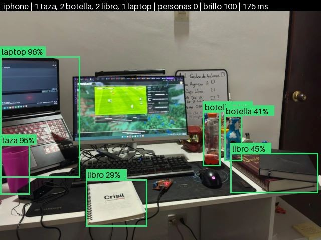
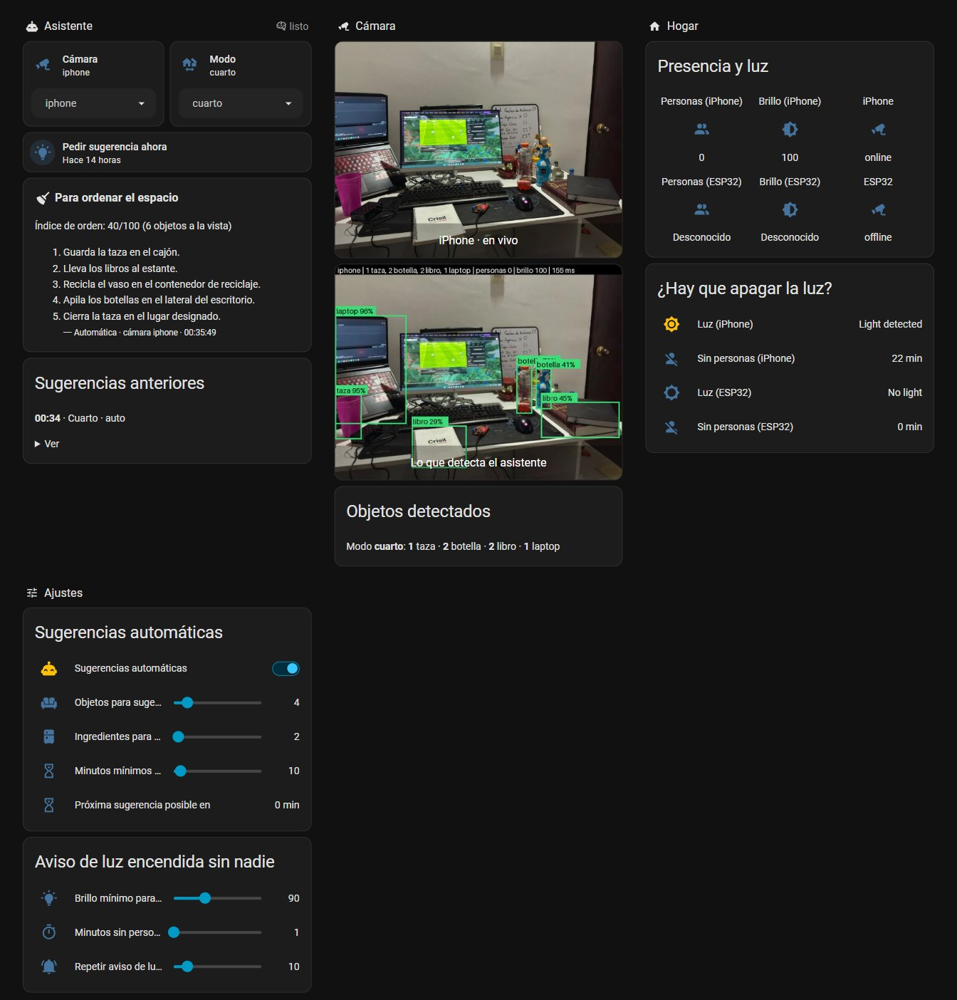
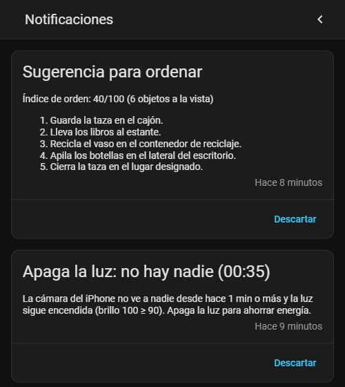

# Asistente doméstico con visión

**Proyecto final — Inteligencia Artificial**

**Integrantes**

| Nombre | Código |
|---|---|
| Cesar Camilo Hoyos Diaz | 20222207570 |
| Álvaro Julián Delgado Mena | 20222208840 |
| Dawin Alexis Guarin Ipuz | 20202192954 |

## 1. Qué es
Un asistente del hogar que **ve** un espacio con cámaras, **identifica** los objetos y **actúa**: propone recetas
con lo que hay en la nevera, sugiere cómo ordenar un cuarto, mantiene una lista de compras y avisa cuando queda una
luz encendida sin nadie. Todo corre **localmente** en una Raspberry Pi 5 con Home Assistant; no usa servicios en la nube.

Cumple el punto 2 del enunciado (ESP32-S3 + Home Assistant + modelo FOMO de Edge Impulse que cuenta objetos) y lo
extiende con un LLM local (Ollama) que actúa como asistente.

## 2. Idea de diseño
La **visión** y el **razonamiento** están separados. Los detectores convierten la imagen en una lista de objetos y el
LLM solo recibe esa lista en texto. Un modelo de lenguaje con visión tardaría minutos por imagen en la Raspberry Pi;
un detector tarda milisegundos y el LLM pequeño responde con poco texto.

## 3. Modelos usados

| Modelo | Dónde corre | Función | Optimización |
|---|---|---|---|
| FOMO (MobileNetV2) — Edge Impulse | ESP32-S3 | Contar objetos propios (huevo, leche, tomate…) | int8, EON Compiler, 96×96 gris |
| YOLOv8n / YOLOv8s (COCO) | Raspberry Pi (servicio vision) | Detectar objetos comunes, personas y medir brillo | ONNX; YOLOv8n 320 px (bajo consumo) o YOLOv8s 640 px (más preciso), configurable |
| gemma3:1b (Q4) | Raspberry Pi (Ollama) | Recetas y consejos de orden en español | Cuantizado, contexto 1024–2048, temperatura 0.3 |

## 4. Arquitectura

```
 ESP32-S3 ─┐                          ┌─▶ Home Assistant (video en vivo)
           ├─▶ go2rtc (relé de video) ┤
 iPhone ───┘                          └─▶ vision (YOLOv8n) ──┐
                                                             │ MQTT (Mosquitto)
 ESP32 con FOMO ── casa/camara1/detecciones ─────────────────┤
                                                             ▼
                         cerebro (mediana, sugerencias automáticas, historial SQLite)
                                                             │ texto
                                                             ▼
                                                     Ollama (gemma3:1b)
                                                             │
                              respuesta ──▶ Home Assistant (dashboard y notificaciones)
```

| Servicio (Docker) | Función |
|---|---|
| Mosquitto | Bus MQTT entre todas las piezas |
| go2rtc | Una sola conexión por cámara, repartida a HA y a vision (las cámaras solo admiten un cliente) |
| vision | YOLO sobre las cámaras IP: objetos, personas, brillo e imagen anotada |
| cerebro | Estabiliza el conteo (mediana), decide cuándo sugerir, consulta al LLM y guarda el historial |
| Ollama | LLM local |
| Home Assistant | Dashboard, ajustes, automatizaciones y notificaciones |

## 5. Funcionamiento
1. Las cámaras (ESP32-S3 y un iPhone con IP Camera Lite) envían video a go2rtc.
2. vision analiza un cuadro cada 2–3 s con YOLO y publica por MQTT los objetos, las personas y el brillo.
3. cerebro estabiliza el conteo con la mediana de las últimas lecturas y publica el inventario.
4. **Sugerencias automáticas:** con suficientes objetos (cuarto ≥ 4, cocina ≥ 2), la escena estable 20 s, el
   intervalo mínimo cumplido (10 min) y un cambio real en la escena, cerebro pide al LLM una receta o un consejo de
   orden (en el cuarto, el índice de orden lo calcula el sistema y el LLM redacta las acciones). La sugerencia se mantiene en pantalla, queda en el historial y se notifica.
5. **Aviso de luz:** si una cámara no ve personas durante N minutos y el brillo indica luz encendida, HA avisa
   "Apaga la luz: no hay nadie" y lo repite cada 10 minutos mientras siga así.
6. **Lista de compras:** si faltan huevos o leche, se añaden a la lista. A las 19:00 llega un resumen con una receta.

El dashboard tiene cuatro secciones: **Asistente** (cámara, modo, sugerencia e historial), **Cámara** (video en vivo y
detecciones), **Hogar** (presencia, luz, lista de compras) y **Ajustes** (mínimos, intervalos y umbrales).

## 6. El sistema en funcionamiento
Escena de un escritorio vista por la cámara del iPhone, procesada por el sistema completo
(go2rtc → vision → cerebro → Ollama → Home Assistant) en modo cuarto.



 

1. vision detecta los objetos de la escena y publica el conteo, las personas y el brillo.
2. Con 6 objetos y la escena estable 20 s, cerebro genera **sola** la sugerencia de orden: el índice (40/100) lo
   calcula el sistema a partir de los objetos y el LLM redacta las acciones.
3. Como no hay personas y la imagen está iluminada, Home Assistant avisa **"Apaga la luz: no hay nadie"**.

## 7. Estructura del repositorio

| Carpeta | Contenido |
|---|---|
| `firmware/esp32_fomo_mqtt/` | Firmware FOMO + MQTT para la ESP32-S3 |
| `edge-impulse/` | Notas del entrenamiento y lugar de la librería exportada |
| `pi/` | Docker Compose, cerebro, vision, go2rtc, Mosquitto, Ollama y Home Assistant |
| `tools/` | Simulador del ESP32, captura de dataset y benchmark del LLM |
| `docs/` | Documentación completa, contrato MQTT, arquitectura y pruebas |

## 8. Implementación
- Stack completo en Docker en una Raspberry Pi 5 compartida con otro proyecto (puertos 8124, 1884, 11435, 1984).
- Servicio cerebro con estabilizador, sugerencias automáticas, historial y 20 pruebas automáticas.
- Servicio vision con YOLOv8n en ONNX (60–180 ms por imagen en la Pi), lectura continua de video y reconexión.
- Dos cámaras intercambiables (ESP32-S3 e iPhone) con go2rtc para video fluido.
- Home Assistant con sensores MQTT, automatizaciones (compras, luz, resumen, sugerencias) y dashboard por secciones.
- Perfiles de rendimiento configurables (normal y bajo consumo) desde `pi/.env`.

Documentación completa: `docs/DOCUMENTACION.md`.
