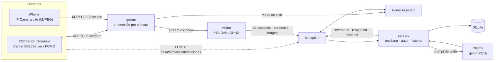
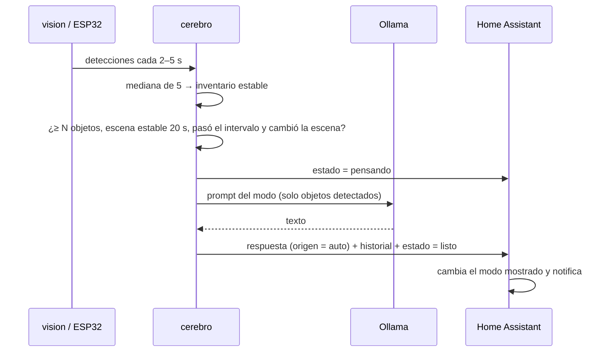

# Arquitectura

## Flujo de datos (versión actual)

## Contenedores (Docker Compose, `pi/docker-compose.pi-compartida.yml`)

| Servicio | Imagen | Puerto en la Pi | Función |
|---|---|---|---|
| mosquitto | eclipse-mosquitto:2 | 1884 | Broker MQTT con usuario y clave |
| homeassistant | home-assistant:stable | 8124 | Interfaz, automatizaciones, notificaciones |
| ollama | ollama/ollama | 11435 (solo local) | LLM local (`asistente` = gemma3:1b + Modelfile) |
| cerebro | build `pi/cerebro` | — | Inventario estable, sugerencias, historial |
| vision | build `pi/vision` | — | YOLO sobre las cámaras IP, presencia y brillo |
| go2rtc | alexxit/go2rtc | 1984 | Relé de video: una conexión por cámara |

Los puertos están desplazados (8124, 1884, 11435) porque la Pi también aloja otro proyecto con
Home Assistant y Mosquitto propios.

## Secuencia de una sugerencia automática

## Red
Dos opciones:
1. **Red existente** (la usada en las pruebas): Pi, ESP32 e iPhone en el mismo WiFi 2.4 GHz.
   Acceso remoto por Tailscale (`http://100.90.171.87:8124`).
2. **Red propia de la Pi** (`pi/scripts/crear_hotspot.sh`): red `AsistenteCasa`, Pi en `10.42.0.1`.
   No usar si la Pi depende de su WiFi para otro proyecto (corta la conexión actual).
